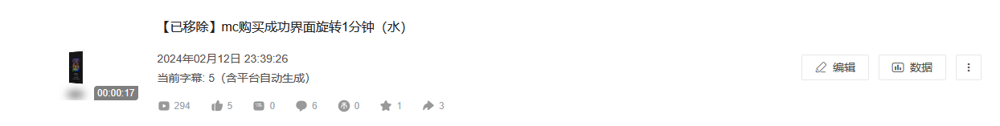
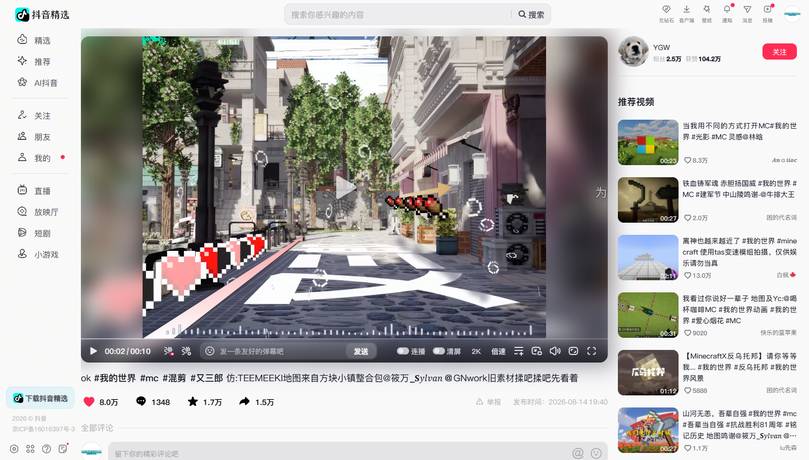
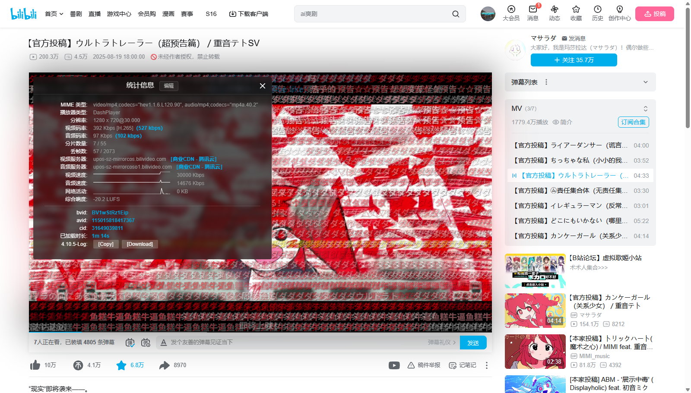
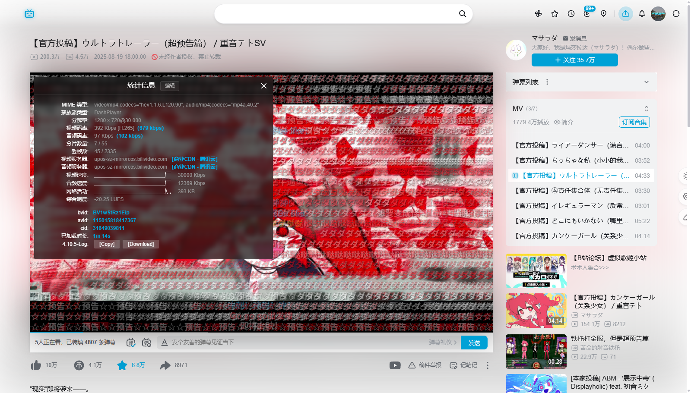

# wednesxuan.github.io

一个 GitHub 个人仓库，创建于 2025 年 7 月，存放着一些小东西。
> [!IMPORTANT]
> 该仓库仍然在建设中，你现在看到的是半成品readme
## 一个视频

这是本人于 2024 年 2 月 12 日在 B 站账号上传的第一个视频。视频内容只是一个简单的购买成功界面旋转一分钟，后自行移除，但仍上传在这里长期存储。

https://github.com/user-attachments/assets/069eadf5-37ed-4b30-bd5c-e76d1ab798f5

## 一些小东西

为满足个人需要，而通过 **[DeepSeek](https://www.deepseek.com/news/v4-preview/)** 编写，以存档的形式发布在这里

（于 2026 年 7 月到 2026 年 10 月在网页端编写，根据官方文档的记载，当时网页端快速模式并开启深度思考的情况下，使用的是 v4-flash 模型。）

> [!IMPORTANT]
> 下面的东西大多为 AI 编写的代码，我只经过可用性检查以及简单的安全性检查，可能仍然有 bug 尚未修复，请谨慎使用。

### 1. BetterDouyinPlayer

这是最早用 AI 编写的一个 JavaScript 脚本。它的原型是用于下载在部分设备上不予开放的更高画质的视频流的浏览器书签，但经过不断的优化与添加，变成了现在这个样子。

现在的功能包括：

1. 在线观看更高画质的视频流
2. 对于平台允许下载的视频替换新的下载界面
3. 较为简单的界面美化（氛围灯效与网页背景模糊）
4. 画质列表支持显示详细信息
5. ……

在默认状态下的截图：

### 2. BetterBilibiliPlayer

BetterDouyinPlayer 在 bilibili 的移植版。得益于社区贡献的资料以及官方的网站设计，这个脚本的功能稍微全一些。

现在的功能包括：

1. 画质列表支持显示详细信息
2. 一些小功能的添加与增强（播放量与弹幕量的详情显示，站内视频显示视频卡片，第三方 URL 快速跳转与修复，UGC 界面播放器已填充弹幕数恢复显示……）
3. 统计信息界面添加信息与翻译
4. 界面美化（与上面的脚本相同）

在默认设置下的截图：

兼容一些其他的美化插件（因为本人也在使用），比如 [BewlyCat](https://github.com/keleus/BewlyCat)，效果会更好，可以解决原生顶部的状态栏的问题。

还在建设中......
